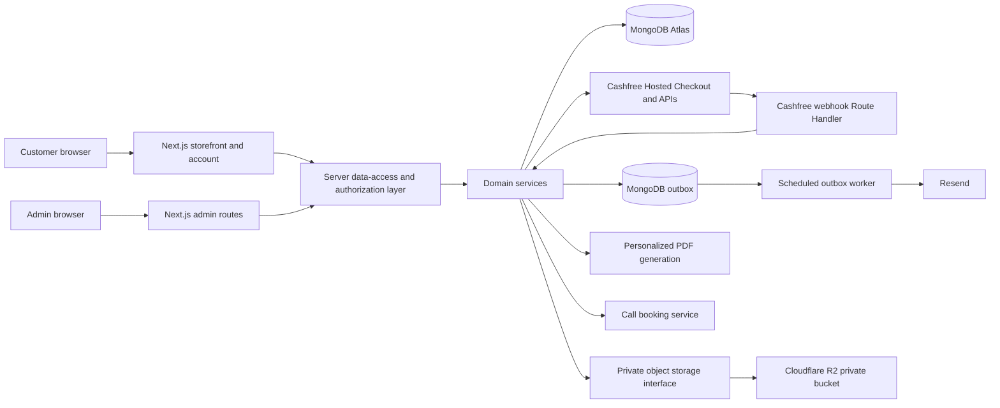

# MoneyTreeVentures — Application Architecture

**Status:** Audited 2026-11-20. Existing Phase 2-5 implementations are present and have local test coverage; this does not imply provider or production verification. Phase 5 production build currently fails on external Google Fonts fetch. See `LAUNCH-READINESS.md` and `phases/PHASE-00-AUDIT.md`.

## Client ownership and responsibilities

MoneyTreeVentures and its production assets/accounts belong to the client. The client owns and controls the GoDaddy domain account, Netlify team/site, the Cashfree merchant account and settlement bank account, MongoDB Atlas organization/project, Cloudflare account/R2 buckets, Resend account, and a public GitHub repository under the client's personal account. The client explicitly approves publication of the complete application source, including backend code. Do not commit secrets, customer data, production exports, or private PDF assets; inspect history and dependencies before publication. Netlify Free is single-seat, so the client remains Team Owner and configures deploy settings/secrets; the developer contributes through GitHub permissions granted by the client. Never share account credentials. Production Cashfree credentials and settlements must never use the developer's personal merchant or bank account.

## Approved product decisions

- Cashfree is the only payment gateway. Use Cashfree Hosted Checkout.
- Google sign-in is mandatory before checkout. A guest cart survives the OAuth round-trip and is restored after login.
- Launch currency is INR. Displayed prices are tax-inclusive; the tax breakdown remains configurable and must be finalized against applicable requirements before launch.
- A purchase grants lifetime access to the product and its future revisions. A completed full refund revokes that entitlement and is recorded in the audit trail.
- Coupons support fixed-amount and percentage discounts, date validity, usage limits, and product restrictions.
- Transactional email uses Resend and a durable outbox.
- Selected hosting target: Netlify Free, subject to its 300 monthly credit hard limit and project suspension behavior; initial database target: MongoDB Atlas Free, subject to its reliability limits; private PDF object storage: Cloudflare R2 Standard.
- Production domain: `https://moneytreeventure.com`, owned by the client at GoDaddy. Redirect `www.moneytreeventure.com` to the root canonical host. Use `staging.moneytreeventure.com` for the isolated staging deployment.
- Cashfree uses separate sandbox and production configuration. Sandbox is connected only to staging/test data; production uses the client's approved merchant account, production domain, and production webhook.
- The initial catalogue contains only individual PDF guides, PDF starter kits, bundles of PDFs, and one 1:1 Call Guidance product. No video, ZIP, audio, or other media delivery is in scope.
- Keep storage behind a provider interface so private PDF objects can move from R2 to Amazon S3 without changing catalogue, entitlement, or download services.
- PDF masters remain private and unchanged. After verified payment, generate a personalized buyer copy with a subtle per-page watermark and store it privately. Downloads require owner checks, short-lived signed URLs, and rate-limited activity logging.
- 1:1 Call Guidance uses a separate booking entitlement and booking workflow. It never creates a PDF download.
- The completed homepage, global styles, theme provider, navigation, and design components remain in place.

## Existing application baseline

The repository is a Next.js 16.4.6 App Router app with React 19, strict TypeScript, Tailwind CSS v4, Motion, Lucide, and `next-themes`. The homepage is assembled in `src/app/page.tsx`; its existing sections live under `src/components/home/`. `next.config.ts` enables Cache Components and Partial Prefetching. Phase 2.1–2.5 provide lazy environment/database infrastructure, Mongoose models, error/logging utilities, and R2/Cashfree provider foundations. Phase 3 provides Better Auth with Google sign-in, idempotent profile provisioning, server/client session utilities, and protected admin operations. Phase 4.1–4.6 adds category/product management, cart/coupons/orders, Cashfree Hosted Checkout and webhook/refund processing, private personalized PDF delivery, separate Call Guidance bookings, customer/admin workflows, and transactional email. The README documents local setup and checks. The application has not been deployed, live OAuth and provider flows have not been verified, and production database indexes have not been applied.

Keep `src/app/page.tsx` and the existing homepage/design-system files as they are. Add new routes and server modules beside them. The product names shown by the current homepage are presentation content, not permission to create published catalogue records.

## Recommended technology stack

| Concern | Choice | Notes |
|---|---|---|
| App and UI | Existing Next.js App Router, React 19, TypeScript, Tailwind v4, Motion | Preserve the current architecture and visual system. Server Components remain the default. |
| Database | MongoDB Atlas Free initially and Mongoose | Use the Atlas replica-set deployment for transactions and a reusable connection in warm Node runtimes. Free-cluster limits and lack of backups make it an early-stage option, not a production reliability guarantee. |
| Authentication | Better Auth, official MongoDB adapter, Google OAuth and database sessions | Better Auth auth records remain separate from the app `users` profile/authorization collection. Profiles link only through Better Auth user ID and roles are never supplied by an OAuth provider. [Next.js integration](https://better-auth.com/docs/integrations/next), [Google provider](https://better-auth.com/docs/authentication/google), [MongoDB adapter](https://better-auth.com/docs/adapters/mongo) |
| Validation and forms | Zod on all server boundaries; React Hook Form + Zod resolver for complex admin forms | Browser validation improves feedback but never replaces server validation. |
| Payment | Cashfree server-side REST API and Cashfree JavaScript SDK with Hosted Checkout | The server creates and verifies provider orders; the browser receives only the payment session ID. No client-side Cashfree secret or custom card-entry form. [Cashfree Hosted Checkout](https://www.cashfree.com/docs/payments/online/web/redirect) |
| PDF storage | Private Cloudflare R2 Standard bucket, through a provider-independent object-storage interface | Keep PDF masters and personalized copies private. Issue a short-lived R2 S3-compatible presigned URL only after session, entitlement, and rate-limit checks. Presigned URLs are bearer credentials. [R2 pricing](https://developers.cloudflare.com/r2/pricing/), [R2 presigned URLs](https://developers.cloudflare.com/r2/api/s3/presigned-urls/) |
| Email | Resend | Receipt/status email is sent through a durable outbox worker. |
| Jobs | MongoDB outbox with bounded post-commit/request-triggered processing and a replay path | Persist work before attempting it. Optional scheduled catch-up must fit the selected host's plan; do not assume an always-on worker or free high-frequency cron. |
| Search | MongoDB indexes/text search at launch | Avoid operating a separate search service prematurely. |

The existing application uses Mongoose, Zod, Better Auth and its Mongo adapter, AWS SDK v3 for the S3-compatible R2 API, `pdf-lib` for buyer-copy watermarking, Cashfree's server-side REST integration, Resend, and Node's built-in test runner. Use the same storage adapter contract for R2 and a possible later S3 provider. Do not add dependencies before the relevant phase needs them.

## Application boundaries

Use one Next.js application with clear server-side domain modules. Route Handlers serve APIs and integrations; Server Components call server services directly rather than making an HTTP request back into the same app. Mark authentication, database, Cashfree, email, and storage modules as server-only.

### Customer-facing routes

- `/` ? existing homepage.
- `/products` and `/products/[slug]` ? published database-backed product catalogue and detail pages.
- `/cart`, `/checkout`, `/checkout/[orderId]`, and `/checkout/return` ? cart, authenticated checkout, order checkout, and payment-status return page.
- `/account` — customer-owned orders, PDF library, and booking history; `/resources` redirects to `/products`.
- `/about`, `/contact`, `/faqs`, `/privacy-policy`, `/terms`, `/refund-policy`, and `/shipping-delivery` ? public information and draft policy pages.
- `/login` retains Google customer sign-in and links to `/admin/login` below it. `/admin/login` is a public route-group page, separate from the protected admin layout; anonymous `/admin` requests redirect there.
- `/admin`, `/admin/products`, and `/admin/bookings` ? protected administrator pages.

Website language is currently Roman Hinglish (`lang="hi-Latn-IN"`). The Phase 0 brief changes the target to English by default with English, Devanagari Hindi, Roman Hinglish, and Tamil options; this is not implemented yet. Product content must come from approved real material.

### Admin routes

`/admin` will cover product/category publishing, PDF asset versions, coupon management, FAQ/settings editing, order/payment lookup, contact triage, 1:1 call booking management/confirmation, and audit history. Every protected read and mutation must call server-side authorization. A hidden link, layout check, or Proxy redirect is not an authorization boundary.

### API responsibilities

Route Handlers will cover auth integration, catalogue reads where needed, checkout/order creation, customer-owned order status, the Cashfree webhook, library downloads, and admin mutations. Webhook and download endpoints are server-only Node routes. Add Zod validation and explicit response DTOs at each boundary.

## Authentication and authorization

- **Phase 3.1–3.2 identity foundation implemented:** Better Auth is initialized lazily in a server-only module, and its GET/POST API is mounted at `/api/auth/[...all]` using the official Next.js handler. Google OAuth is the only configured provider. The Node route reuses the existing Mongoose connection's native Mongo `Db` and `MongoClient`; no second database pool is created.
- Better Auth authentication records use separate `authUsers`, `authSessions`, `authAccounts`, and `authVerifications` collections. The existing Mongoose `users` collection remains the application profile and authorization source. They are linked only by stable Better Auth user ID (`authUserId`); email is never an identity join key.
- Email/password is disabled. Google OAuth requests only `openid`, `email`, and `profile`. `/login` provides the sign-in action and authenticated state, while `getCurrentSession`, `getCurrentCustomer`, and `requireCustomer` provide server-side session/profile checks.
- New application profiles are upserted by `authUserId` with `$setOnInsert`; new roles are always `customer`. The unique `authUserId` index must exist in MongoDB for concurrent provisioning to converge safely. Existing profile fields and roles are not overwritten. Server-side customer retrieval retries provisioning if a prior post-create hook failed.
- Production auth configuration requires a server-only secret of at least 32 characters and an HTTPS base origin. Cookies are HttpOnly and SameSite=Lax, with Secure enabled in production. Missing auth or Mongo configuration returns a safe server error from the auth API; the public homepage and build do not require those values.
- Google OAuth identities receive an application profile with the `customer` role on insertion. Provider data can never grant `admin`.
- Better Auth owns future OAuth account linking and database sessions. Application role/status remain server-controlled in the profile model, outside provider claims.
- The bootstrap CLI requires prior owner Google sign-in, a verified owner identity, exactly one linked Google provider, and an active matching profile. It revalidates identity inside the Mongo transaction, changes only the role, and writes an audit event. It requires explicit promotion and non-production confirmations and refuses `NODE_ENV=production`; the operator must verify the configured DB is non-production before running it.
- `getCurrentAdmin()` and `requireAdmin()` require a server-authenticated Better Auth session, verified Google identity from `authUsers` plus one `authAccounts` Google link, normalized owner email `moneytreeventuress@gmail.com`, and a matching active `admin` application profile. Current profile role/status are checked on each protected request. Browser-provided identity, email, role, local storage, URL, and headers are not authorization inputs.
- `/admin` and all protected admin pages use a server-rendered layout. Anonymous requests redirect to `/admin/login`; signed-in but unauthorized identities receive a restricted-access page. The public `/admin/login` page uses the existing Better Auth Google callback and a fixed `/admin` return path.
- `withAdmin()` is the reusable server-side API Route Handler wrapper. Existing admin APIs return 401 for anonymous requests and 403 for signed-in non-owners. Admin and customer account pages use a shared Better Auth logout control; successful sign-out fully navigates away to clear in-memory protected route content without clearing the guest cart.
- Proxy may provide early redirects only. Every sensitive data read/write still checks the session and current database role.
- Checkout requires sign-in. The guest cart stores only product identifiers and quantities, not trusted prices or personal data. After Google OAuth, restore the cart, re-fetch current product availability/prices, and show the recalculated total. Clear purchased cart lines only after the server confirms success.

## Catalogue and the intended ten products

The catalogue supports `pdf_guide`, `pdf_starter_kit`, `pdf_bundle`, and `call_guidance` product kinds. A bundle snapshots its included PDF products/assets at purchase. `call_guidance` is fulfilled only through a booking entitlement and booking record; it has no PDF asset or download path. Do not invent product names, prices, descriptions, files, testimonials, or statistics. Create records only as unpublished drafts after the approved list and real product material are available. Nothing is seeded or published by this documentation change.

Public catalogue data is server-rendered. Product edits/publications invalidate the relevant Next.js cache tags. Public descriptions and prices may be cached; user-specific cart, order, library, payment, webhook, and download responses must not be shared or cached.

## Payment fulfilment, access, and audit

Payment attempts are separate from orders. Order lines preserve immutable title, product ID, unit price, tax/discount/total snapshot, and currency. A verified successful Cashfree payment is the only event that may activate a purchase. See [PAYMENT-FLOW.md](./PAYMENT-FLOW.md) for the complete sequence and failure states.

A PDF purchase entitlement points to a product, not to a single file version. It grants access to future revisions, each delivered as an individually watermarked copy. For a bundle, the immutable order snapshot records included PDFs and the grant authorizes those items under that purchase. A Call Guidance purchase instead creates a booking entitlement and a booking record after verified payment; administrators manage scheduling and confirmation, and the customer sees only their own booking. A completed full refund revokes the corresponding entitlement and is recorded with its actor/reference in the audit trail. Refund initiation alone does not revoke access; wait for confirmed completion. Partial-refund behaviour remains to be approved.

### PDF personalization and download protection

- Keep the original approved master PDF unchanged in the private R2 bucket. No public bucket, public object URL, or master-PDF URL is exposed.
- Only after the payment transaction confirms exact order identity, amount, INR currency, and successful Cashfree status may a personalization job be created.
- Generate one customer copy per buyer and PDF version. Add a subtle, legible watermark containing buyer name, registered email, merchant order reference, and purchase date, plus an approved copyright/personal-use notice. Do not invent legal owner details or notice copy.
- Store personalized copies under opaque, unguessable private object keys, with owner, purchase, source version, and checksum metadata. Generation is idempotent; failed work can retry without changing the master.
- Require an authenticated owner check, active entitlement, and rate-limit approval before signing a short-lived `GET` URL. Do not accept object keys from the browser as authorization.
- Log each authorized download-link request, including user, purchase, file version, timestamp, and outcome; apply per-user rate limits with a bounded counter window. Do not log the signed URL or watermark PII into application logs.
- A signed URL is a bearer token until expiry and can be forwarded during that interval. Application logs prove that a link was issued, not that the recipient completed a download. Actual object-read telemetry would require an additional storage-event or proxy design and must be reviewed before adding cost/complexity.
- PDF watermarking is CPU/memory work in a serverless runtime. Set an approved PDF size/page limit and benchmark real files against the selected Netlify Function limits and credit budget; oversized PDFs may need a separate worker and additional hosting cost.
- The customer account must never be able to read another customer's personalized copy or booking. Admin access is separately authorized and audited.

### 1:1 Call Guidance booking workflow

On verified payment, the payment transaction creates a `bookingEntitlement` and a pending `booking` record (or durable booking-creation outbox event). It does not create a purchase PDF or call the PDF generator. The customer account shows the booking's current status and approved scheduling instructions. The customer submits availability/contact details through an authenticated owner-scoped route; an authorized administrator reviews, schedules, and confirms the booking. Status changes and admin actions are audited. Scheduling is manual for the first release; calendar integrations are out of scope.

## Performance, SEO, and caching

- Preserve the existing `cacheComponents` configuration. Cache only public catalogue data and invalidate tags after admin changes. Next.js documents tag-based revalidation for Cache Components. [Next.js revalidating](https://nextjs.org/docs/app/getting-started/revalidating)
- Use compound indexes for catalogue filtering/sorting, order history, payments, purchases, and outbox polling. Paginate server-side.
- Generate metadata, canonical URLs, sitemap, and Product structured data from real published records. Do not emit review/rating markup without genuine reviews.
- Keep interactive client components limited to cart/search/forms; keep business rules and secrets server-side.

## Hosting decision and compatibility

**Selected: Netlify Free.** Netlify's Acceptable Use Policy explicitly allows using Netlify to build, deploy, and host websites for third parties; it prohibits reselling or providing Netlify itself as a standalone hosting service without a written agreement. This covers hosting this client-owned commercial marketplace under the client's account. Recheck the terms before launch. [Netlify Acceptable Use Policy](https://www.netlify.com/legal/acceptable-use-policy/)

Netlify's maintained OpenNext adapter is the supported deployment path. Existing Next.js 16.4.6 App Router, server rendering, Route Handlers, and Cache Components are documented as supported. Connect the existing Git repository in Netlify; let the adapter be automatically configured and updated. Do not add or pin the adapter without a demonstrated compatibility need. Preserve `next.config.ts` and verify the production build and cache behavior in a Netlify deploy. [Next.js on Netlify](https://docs.netlify.com/build/frameworks/framework-setup-guides/nextjs/overview/)

Keep hosting portable: build on standard Next.js App Router and Node APIs, avoid Netlify-specific runtime APIs in domain/business modules, and isolate host setup in deployment configuration. Keep persistence, storage, payment, and email integrations behind existing provider boundaries. If hosting changes later, re-run the same build, route, cache, webhook, and security acceptance checks against the destination adapter before switching traffic.

Free includes 300 credits per month with a hard limit and no automatic recharge. Production deploys cost 15 credits each; deploy previews, branch deploys, and failed deploys are non-metered. Usage is shared across the team's web projects. When the monthly allotment is exhausted, all team web projects pause, visitors see an unavailable page, and production deploys stop until the monthly reset or a paid-plan upgrade. Monitor credits and bandwidth/function usage; this plan has no production availability guarantee. [Credit-based plans](https://docs.netlify.com/manage/accounts-and-billing/billing/billing-for-credit-based-plans/credit-based-pricing-plans/), [credit-limit behavior](https://docs.netlify.com/manage/accounts-and-billing/billing/billing-for-credit-based-plans/billing-faq-for-credit-based-plans/)

The domain stays registered with GoDaddy and its DNS remains there. Add the domain to Netlify, then use only the project-specific DNS values shown in Netlify's Domain management screen; do not copy generic records from documentation. Point the apex to Netlify and configure the `www` alias/redirect and staging hostname as shown by that project. Netlify provisions and renews HTTPS after DNS validation. No domain transfer or nameserver change is required. See [DEPLOYMENT.md](./DEPLOYMENT.md); no DNS changes are authorized by this document. [External DNS](https://docs.netlify.com/manage/domains/configure-domains/configure-external-dns/), [Netlify HTTPS](https://docs.netlify.com/manage/domains/secure-domains-with-https/https-ssl/)

## Deployment and operations

- **Netlify Free:** selected hosting. Free is $0/month and includes 300 credits/month with a hard limit; production deploys consume 15 credits, while deploy previews, branch deploys, and failed deploys are non-metered. Exhaustion pauses all team projects. Commercial third-party client hosting is allowed by the AUP, subject to its restrictions. The selected public personal-account GitHub repository is eligible for Git deployment; the Free single-seat limit means the client owns and operates the Netlify dashboard. [Plan details](https://docs.netlify.com/manage/accounts-and-billing/billing/billing-for-credit-based-plans/credit-based-pricing-plans/), [AUP](https://www.netlify.com/legal/acceptable-use-policy/)
- **MongoDB Atlas Free:** the M0 cluster has 512 MB storage, limited operations/features, no managed backups, and can pause after 30 days with no connections. Suitable for development/early validation, but budget an upgrade or backup plan before relying on it for production customer/order data. [Free cluster limits](https://www.mongodb.com/docs/atlas/reference/free-shared-limitations/)
- **Cloudflare R2 Standard:** currently includes 10 GB-month, 1 million Class A operations, 10 million Class B operations monthly, and free internet egress. Beyond that, current rates are $0.015/GB-month, $4.50/million Class A, and $0.36/million Class B requests; excess is usage billed. Enabling R2 requires an R2 subscription checkout, so confirm account/payment setup and current billing terms. Never enable public access. [R2 pricing](https://developers.cloudflare.com/r2/pricing/), [getting started](https://developers.cloudflare.com/r2/get-started/)
- **Better Auth and Google OAuth:** the Better Auth library is free/open source and self-hosted; Google OAuth has no per-login charge assumed here, subject to Google's current terms/quotas. [Better Auth pricing](https://better-auth.com/pricing), [OAuth provider docs](https://better-auth.com/docs/concepts/oauth)
- **Resend Free:** currently includes 3,000 emails/month and 100/day. Limit exceeded may require an upgrade or explicitly enabled overage billing; receipt and booking email volumes must be monitored. [Resend pricing](https://resend.com/pricing)
- **GitHub Free:** the client-approved personal-account repository will be public, so source and commit history are visible to anyone. Netlify supports Git deployments from public repositories on Free. Review secrets/history, dependencies, and repository contents before publication; never commit secrets, customer data, production exports, or private PDF masters. [GitHub plans](https://docs.github.com/en/get-started/learning-about-github/githubs-plans)
- **Cashfree:** payment processing is not free. Its published standard domestic gateway fee is currently 1.95% per successful transaction plus applicable GST (payment-method rates and negotiated terms can differ); setup fee is currently listed as zero. Temporary offers are eligibility- and time-limited and are not the operating budget assumption. Confirm merchant-specific fees and taxes before launch. [Cashfree fees](https://www.cashfree.com/payment-gateway-charges/)
- **Domain:** client-owned `moneytreeventure.com` is the official production host. Do not buy or transfer a domain. Netlify provisions HTTPS after GoDaddy DNS records validate.
- R2 and other usage-based services can incur charges beyond their included usage. Set usage alerts, inspect invoices, and track object storage/download volumes. If keeping spend at zero is mandatory, configure hard application-level limits and disable public checkout when limits or required commercial plans are exceeded.
- Netlify's maintained OpenNext adapter serves the Next.js runtime. Preserve App Router and Cache Components configuration, and do not pin the adapter version without a verified need.
- MongoDB Atlas uses a replica-set deployment in a region near the intended customer base.
- R2 Standard stores private PDF originals and personalized outputs. Never enable public-bucket access. Store R2 S3-compatible credentials only as server secrets, use least-privilege bucket-scoped tokens, and keep the adapter provider-independent for a later S3 migration.
- Resend uses a verified sending domain.
- Cashfree sandbox and production credentials, callback domains, and webhook configuration are separate. Whitelist the production domain in Cashfree before live checkout.
- The outbox makes email/PDF jobs durable and retryable independently of payment confirmation. A worker failure must not roll back a confirmed payment. On no-cost hosting, process bounded work after relevant requests and provide an authorized replay path; reliable scheduled processing may require a paid/eligible plan or an additional service.
- Keep structured logs and audit records, but redact secrets, full signed URLs, and unnecessary personal/payment data.

## Historical implementation phases (current recovery sequencing is in PROJECT-TRACKER.md)

## Historical Phase 0 audit snapshot (superseded by current Phase 1 and Phase 2 results)

At the Phase 0 checkpoint, production build, smoke, and client-bundle checks were blocked and strict owner-only admin authorization, `/admin/login`, and account logout were missing. Current Phase 1 removed the Google Font build dependency and the production build/smoke/client-bundle checks passed locally. Current Phase 2 implements the sole-owner policy, bootstrap safeguards, login routes, and logout controls; real Google OAuth, Mongo session, and owner bootstrap remain unverified. Static homepage product examples, custom 404, dynamic product sitemap, and external/staging verification remain open. See [LAUNCH-READINESS.md](./LAUNCH-READINESS.md) and the phase reports for current evidence.

1. **Phase 2 — Project foundation:** complete in the workspace; no production secrets or database indexes were configured.
2. **Phase 3 — Identity and admin authorization:** complete in the workspace; live Google OAuth remains unverified.
3. **Phase 4.1.1–4.1.4 — Catalogue and categories:** category/product management, validation, lifecycle, relationships, APIs, and automated tests are implemented.
4. **Phase 4.2 — Cart, orders, and coupons:** guest cart restoration, INR/tax-inclusive pricing, coupon validation/redemption, and customer-scoped order APIs are implemented.
5. **Phase 4.3 — Cashfree payments:** Hosted Checkout, verified payment reconciliation, webhook idempotency, full refunds, and entitlement revocation/audit are implemented. Sandbox scenarios remain to be run.
6. **Phase 4.4 — PDF fulfilment:** private R2 assets, personalized copies, owner-checked downloads, signed URLs, and download limits are implemented. Provider-backed tests remain to be run.
7. **Phase 4.5 — Call Guidance:** separate booking entitlement, customer booking visibility, and administrator booking management are implemented.
8. **Phase 4.6 — Customer and email workflows:** account/library views, booking status, and durable Resend outbox processing are implemented.
9. **Historical Phase 5: Integration, quality assurance, and launch readiness:** Phase 0 recorded a failed Google Font build. Current recovery Phase 1 now passes the production build, smoke, and client-bundle exact-value scan locally; provider, replica-set, owner OAuth/bootstrap, staging, recovery, and production-domain checks remain outstanding. See [LAUNCH-READINESS.md](./LAUNCH-READINESS.md).

## Phase 2 implementation plan

Phase 2 is limited to foundations. It must not implement OAuth flows, payment initiation/processing, product CRUD, or customer/admin dashboards.

1. **Phase 2.1 complete:** server-environment parsing with Zod, conditional integration-group validation, redacted errors, lazy runtime access, and a Next.js `server-only` boundary. No environment variables are required by the current homepage. See [ENVIRONMENT.md](./ENVIRONMENT.md).
2. **Phase 2.2 complete:** server-only lazy Mongoose connection, `globalThis` hot-reload cache, shared in-flight promise, conservative pool reuse, redacted lifecycle events, and mocked Node tests. No live database was contacted.
3. **Phase 2.3 complete:** strict Mongoose model schemas, domain TypeScript interfaces, explicit indexes, model hot-reload registration, and mocked schema/index tests. No records were seeded and no indexes were deployed. See [DATABASE-DESIGN.md](./DATABASE-DESIGN.md).
4. **Phase 2.4 complete:** shared application errors, normalization for Zod/Mongoose/MongoDB failures, safe JSON response helpers, redacting structured logger, request-scoped ID utilities, and Node unit tests. See [ERROR-HANDLING.md](./ERROR-HANDLING.md).
5. **Phase 2.5 complete:** lazy, server-only Cloudflare R2 S3 client and provider-independent private PDF storage interface; bounded PDF/key/metadata validation; short-lived signed-download creation; Cashfree sandbox/production configuration and a server-only REST transport boundary; safe provider error mapping; and mocked provider tests. No real credentials, provider requests, orders, checkout, refunds, webhooks, uploads, downloads, or PDF generation were used or implemented. See [ENVIRONMENT.md](./ENVIRONMENT.md).
6. Cashfree and R2 remain independent optional integrations. Environment completeness is checked when a provider accessor is requested; the homepage and production build do not require either provider. Malformed supplied values are rejected by environment validation.
7. The R2 interface uses private `masters/` and `personalized/` keys with random UUID components. It does not grant ownership authorization: any future download handler must independently authenticate and verify active entitlement before signing. Signed URLs are bearer credentials and cannot be revoked before their bounded expiry.
8. `npm run db:indexes -- --confirm-database <exact-database-name>` creates the declared model indexes explicitly; it never runs automatically at startup and drops only the named legacy refund index when the operator also passes `--drop-legacy-refund-index`. Review the target, backup, duplicate data, and deployment timing first. Use an Atlas replica set for transaction-capable integration tests.
9. Keep the homepage, CSS, theme provider, Motion animations, and all existing design components unchanged.

## Phase 3.1–3.2 Better Auth identity foundation

Better Auth and `@better-auth/mongo-adapter` are installed at compatible `1.7.25` versions. The official MongoDB adapter receives `connection.db` and `connection.getClient()` after `connectToDatabase()` completes. Mongoose 9 and the adapter share the same MongoDB 7 driver instance, so authentication does not create a separate client or pool. The adapter uses client-backed transactions, consistent with the planned Atlas replica-set topology. The Route Handler relies on Next.js's default Node.js runtime; an explicit `runtime` segment setting is incompatible with the preserved Cache Components setting. [Better Auth MongoDB adapter](https://better-auth.com/docs/adapters/mongo), [Next.js runtime configuration](https://nextjs.org/docs/app/api-reference/file-conventions/route-segment-config/runtime)

`BETTER_AUTH_SECRET`, `BETTER_AUTH_URL`, `GOOGLE_CLIENT_ID`, and `GOOGLE_CLIENT_SECRET` are required when `/api/auth/*` is used. Production base URLs must be HTTPS. Google credentials are validated as a pair and passed only to server-side Better Auth configuration. The endpoint uses Better Auth's supported `toNextJsHandler` integration in the Node runtime; failures are normalized to safe responses without provider/configuration secrets. No auth configuration, DB connection, or external request occurs when the auth module is imported.

Google's local callback is `http://localhost:3000/api/auth/callback/google`; staging and production require their own exact HTTPS callback URI in Google OAuth client configuration. Better Auth handles OAuth state and callback validation. The React client requests only Google sign-in; credentials never enter the client bundle.

Better Auth's `databaseHooks.user.create.after` provisions a customer profile using the trusted Better Auth user ID, name, and email. The Mongoose upsert writes only on insert, assigns `customer`, and relies on the existing unique `authUserId` index. If the post-create hook fails after the Better Auth identity commits, `getCurrentCustomer()` retries idempotent provisioning from the verified server session. `requireCustomer()` rejects missing sessions and blocked/deleted profiles. The hook and database write are not one cross-collection transaction; the retry path is required for recovery.

The server utilities call `auth.api.getSession({ headers: await headers() })`; client state is not an authorization boundary. Phase 3.4 adds profile-based admin guards, a protected `/admin` landing page, the reusable `withAdmin()` Route Handler wrapper, and an operator-run bootstrap CLI with transactional system audit. It does not add admin business operations or promote any user. See [ENVIRONMENT.md](./ENVIRONMENT.md), [DATABASE-DESIGN.md](./DATABASE-DESIGN.md), and [DEPLOYMENT.md](./DEPLOYMENT.md).
